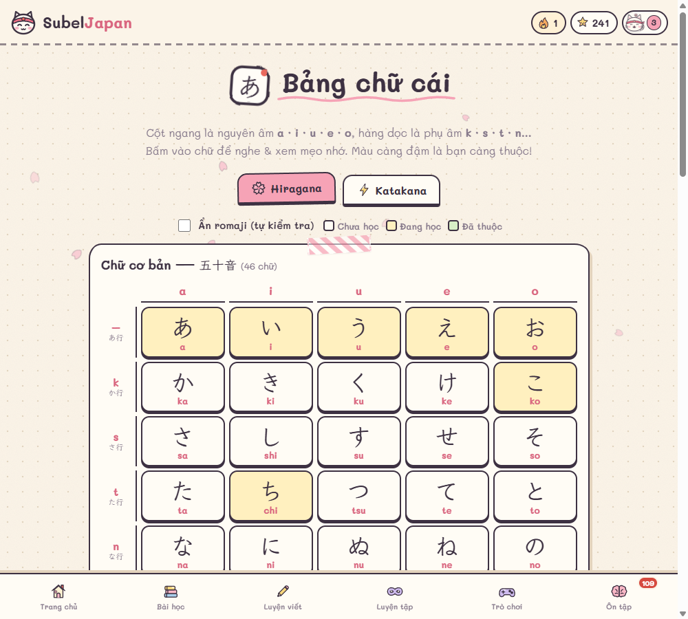
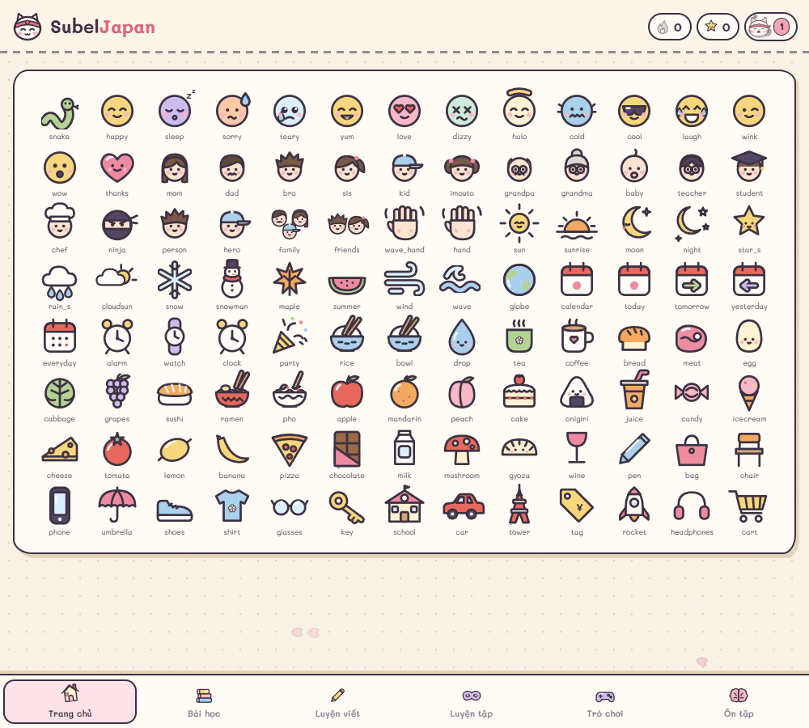

# SubelJapan — Học tiếng Nhật dễ như ăn mochi

Web học **đọc & viết tiếng Nhật cho người mới bắt đầu từ con số 0**, giao diện tiếng Việt, phong cách sổ tay giấy Nhật Bản siêu dễ thương, đồng hành cùng mèo **Mochi**.

**Vào học ngay:** https://pmsubin.github.io/SubelJapan/


## Có gì bên trong?

| | |
|---|---|
| **56 bài học ngắn (3–5 phút)** | Khởi động → Hiragana (16 bài) → Katakana (16 bài) → Từ vựng & giao tiếp (10 bài) → Kanji nhập môn (7 bài) → Ngữ pháp siêu dễ (6 bài) |
| **Đầy đủ mọi chữ** | 46 chữ cơ bản theo bảng **a・i・u・e・o**, âm đục ゛/゜, âm ghép (きゃ…), chữ nhỏ (っゃゅょ…), âm ngoại lai Katakana (ファ, ティ, ヴ…) |
| **Mẹo nhớ bằng tiếng Việt** | Mỗi chữ có cách đọc gần giống tiếng Việt (う = "ư", つ = "chư"…), mẹo hình ảnh, từ ví dụ có hình minh hoạ |
| **Luyện viết có chấm điểm** | Xem hoạt hình thứ tự nét, tô theo chữ mờ trên giấy ô genkō, máy tự chấm 0–100 điểm, chế độ viết liên tục |
| **Luyện tập vô tận** | Đọc / nghe / viết từ trí nhớ / từ vựng / Kanji không giới hạn, có **chuỗi đúng liên tiếp**, ưu tiên chữ bạn hay sai |
| **6 trò chơi** | Thử thách 60 giây, Mưa chữ, Lật thẻ trí nhớ, Nghe chọn chữ, Ghép từ, Đúng hay Sai |
| **Ôn tập thông minh** | Thẻ nhớ lặp lại ngắt quãng (SRS) — tự nhắc đúng lúc bạn sắp quên |
| **Kanji bằng Hán Việt** | 58 Kanji đầu tiên kèm âm Hán Việt (学生 = HỌC SINH), âm On/Kun, ví dụ |
| **Giữ lửa mỗi ngày** | Chuỗi ngày học, mục tiêu XP, 15 cấp độ, 21 huy hiệu, lịch đóng dấu hanko |
| **Tên tiếng Nhật của bạn** | Gõ tên tiếng Việt → đổi sang Katakana + đoạn tự giới thiệu để luyện đọc |




## Tự làm 100%

- **Hình vẽ:** toàn bộ ~240 icon & hình minh hoạ (con vật, đồ ăn, người, mặt cười…) đều được vẽ tay bằng SVG, có hiệu ứng nét bút rung nhẹ — không dùng emoji hay bộ icon có sẵn.
- **Âm thanh:** tự tổng hợp bằng Web Audio — chuông "pin-pon", đàn koto, kalimba theo thang ngũ cung Nhật, bong bóng "pop", con dấu "pon", tiếng mèo "nya~".
- **Phát âm tiếng Nhật:** dùng giọng đọc có sẵn của trình duyệt (tốt nhất trên Chrome / Edge).



## Chạy trên máy

Không cần cài gì — đây là web tĩnh (HTML + CSS + JavaScript thuần).

```bash
git clone https://github.com/PmSubin/SubelJapan.git
cd SubelJapan
npx serve .
```

Hoặc mở thẳng file `index.html` bằng trình duyệt. Tiến độ học được lưu trong trình duyệt (localStorage); có nút sao lưu / khôi phục trong trang Hồ sơ.

## Cấu trúc

```
index.html          khung trang
css/style.css       giao diện sổ tay giấy
js/icons.js         bộ hình vẽ tay SVG
js/data-*.js        dữ liệu Kana, từ vựng, Kanji, bài học
js/store.js         XP, chuỗi ngày, huy hiệu, thẻ nhớ SRS
js/audio.js         phát âm + bộ tổng hợp âm thanh
js/writing.js       hoạt hình nét viết + chấm điểm chữ viết tay
js/lesson.js        trình phát bài học
js/games.js         6 trò chơi
js/practice.js      luyện tập vô tận
js/pages.js         các trang
js/app.js           định tuyến
```

## Ghi công

- Dữ liệu thứ tự nét chữ: [KanjiVG](https://kanjivg.tagaini.net) © Ulrich Apel — giấy phép [CC BY-SA 3.0](https://creativecommons.org/licenses/by-sa/3.0/) (tải trực tiếp khi dùng).
- Phông chữ: [Mali](https://fonts.google.com/specimen/Mali) & [Klee One](https://fonts.google.com/specimen/Klee+One) — SIL Open Font License.
