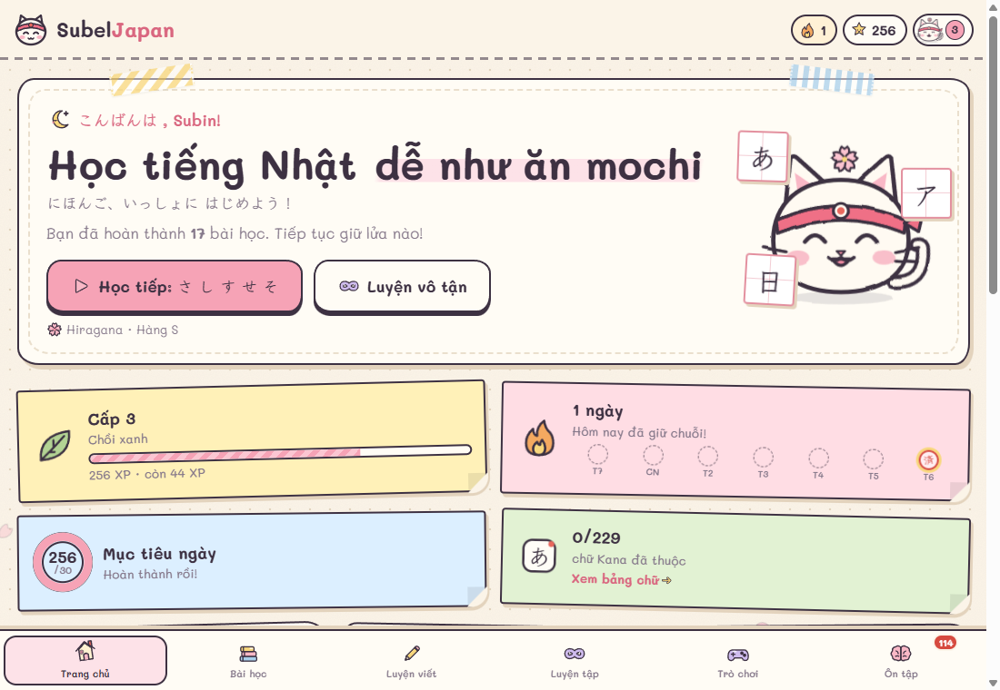
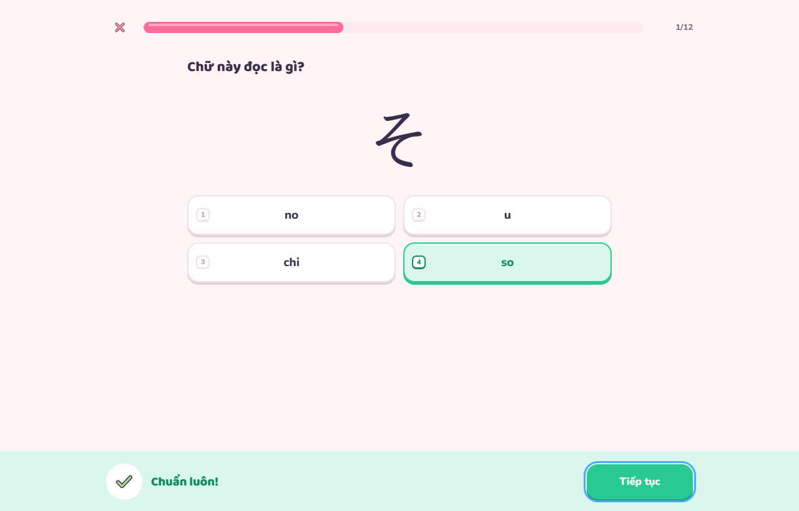
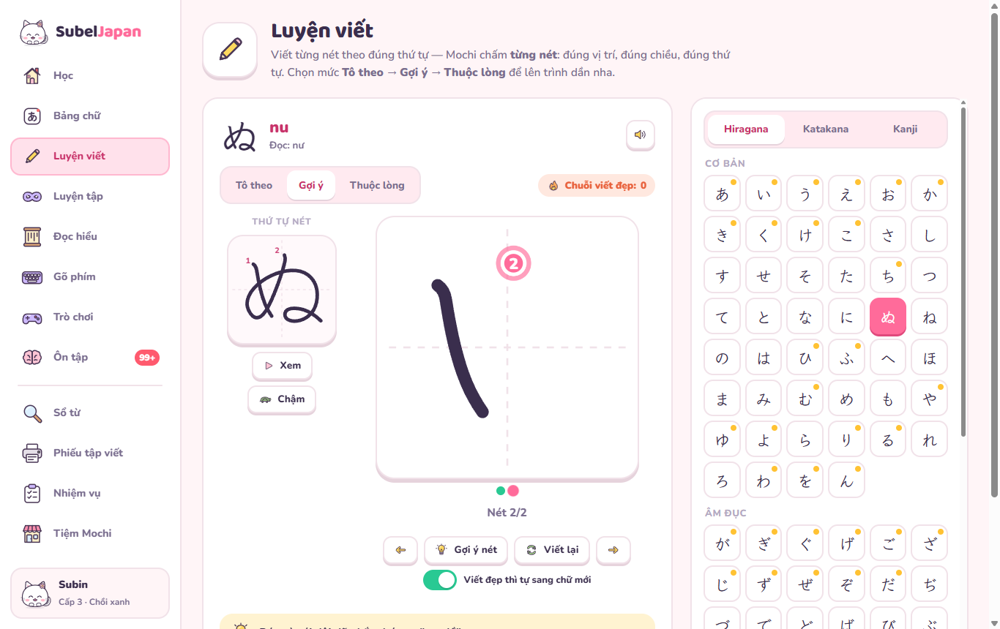
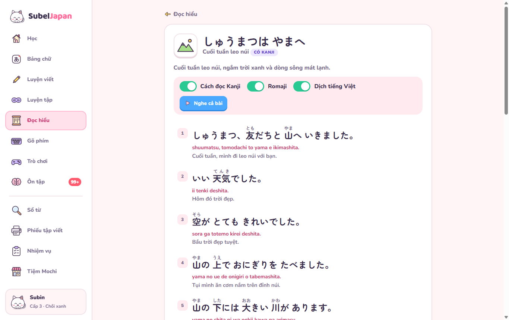
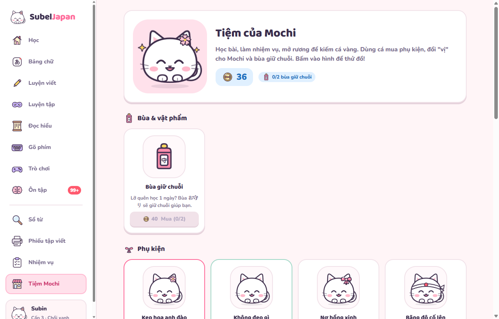
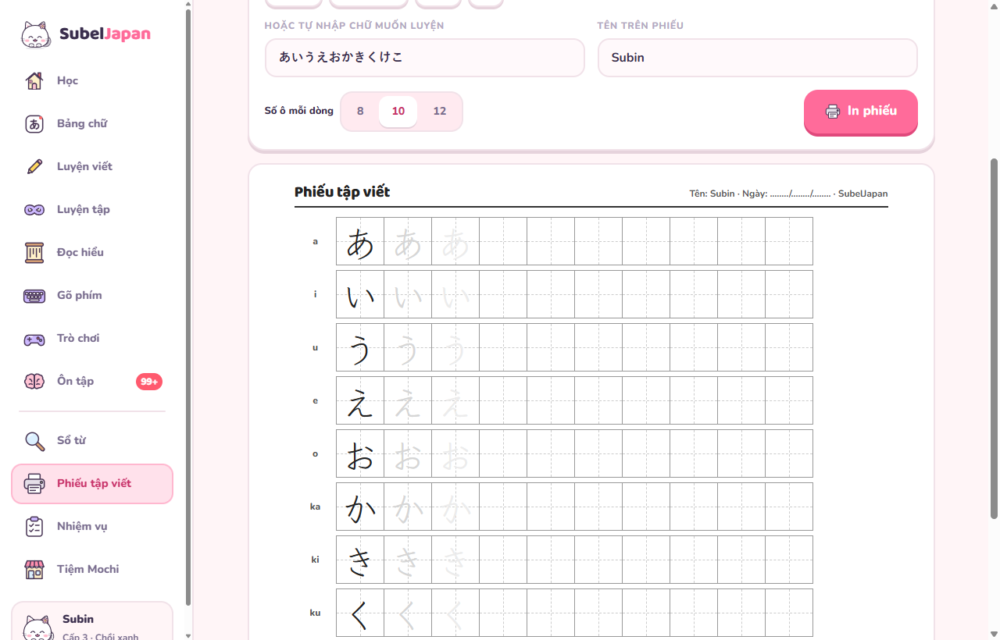
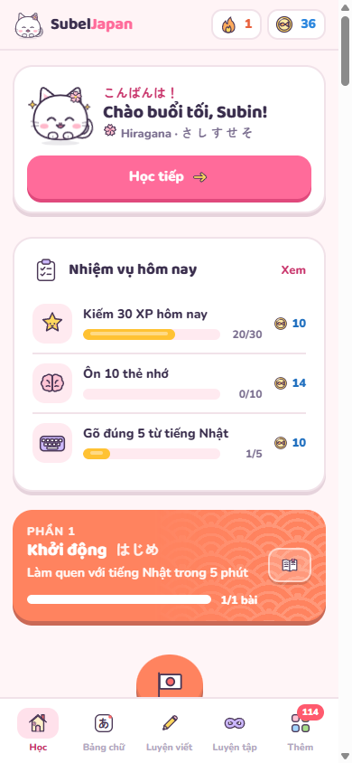

# SubelJapan — Học tiếng Nhật dễ như ăn mochi

Web học **đọc & viết tiếng Nhật cho người mới bắt đầu từ con số 0**, giao diện tiếng Việt, đồng hành cùng mèo **Mochi** siêu dễ thương.

**Vào học ngay:** https://pmsubin.github.io/SubelJapan/



## Có gì bên trong?

| | |
|---|---|
| **Sensei Mochi (AI)** | Gia sư AI chạy bằng **Claude** của Anthropic: hỏi đáp mọi thứ về tiếng Nhật, **luyện hội thoại nhập vai** 10 tình huống (quán cà phê, cửa hàng tiện lợi, hỏi đường, khách sạn…), **sửa câu** có chấm điểm bằng con dấu, giảng ngữ pháp kèm câu đố, dịch Việt ⇄ Nhật. Câu ví dụ nào cũng có furigana, romaji, nghĩa và nút nghe; gõ romaji tự đổi ra kana, nói bằng micro được luôn. |
| **AI trong bài học & truyện** | Trả lời sai thì bấm **“Vì sao?”** để Mochi giải thích kèm mẹo nhớ. **Mochi viết truyện mới** theo trình độ và chủ đề bạn chọn, có giọng đọc, từ vựng, câu hỏi. Sổ từ và bảng chữ có nút hỏi Mochi. |
| **Bản đồ hành trình xứ Nhật** | 6 vùng đất có cảnh riêng (vườn anh đào, phố Tokyo, chợ ẩm thực, núi Phú Sĩ, trời sao đêm), con đường uốn lượn tô màu theo tiến độ, 56 bài siêu ngắn + **16 màn thưởng** (trò chơi, truyện, thử thách viết, gõ phím, chuỗi đúng) + rương cuối mỗi phần. |
| **Nhiều mục tiêu** | Mỗi phần: gom sao, phá màn thưởng để nhận vương miện. Mỗi ngày 3 nhiệm vụ, mỗi tuần 3 thử thách lớn, 10 mục tiêu dài hạn nhiều bậc có thưởng. |
| **Đủ mọi chữ theo a・i・u・e・o** | 46 chữ cơ bản, âm đục ゛/゜, âm ghép (きゃ…), chữ nhỏ (っゃゅょ…), âm ngoại lai Katakana (ファ, ティ, ヴ…). Có mẹo nhớ tiếng Việt và cảnh báo **chữ dễ nhầm** (シ/ツ, ソ/ン, ぬ/め…). |
| **Bài tập đa dạng** | Chọn đáp án, nghe chọn chữ, ghép cặp, gõ romaji, xếp chữ thành từ, **viết từng nét** ngay trong bài. |
| **Luyện viết chấm từng nét** | Dữ liệu nét chuẩn KanjiVG: máy kiểm tra **đúng vị trí, đúng chiều, đúng thứ tự** từng nét. 3 mức: Tô theo → Gợi ý → Thuộc lòng. |
| **Phiếu tập viết in ra giấy** | Tạo phiếu ô vuông genkō (原稿) từ hàng chữ / bài Kanji / chữ tự nhập, in A4 để luyện bằng bút. |
| **Đọc hiểu** | 16 truyện ngắn từ dễ đến khó (có furigana, romaji, dịch tiếng Việt, câu hỏi hiểu bài), 8 hội thoại đời thường (có chế độ đóng vai), 48 câu giao tiếp hay dùng. |
| **Gõ phím tiếng Nhật** | Bộ gõ romaji → kana như bàn phím thật, luyện gõ chữ cái / từ / câu, đo tốc độ, hướng dẫn bật bàn phím Nhật trên máy tính và điện thoại. |
| **Luyện tập vô tận & Ôn tập** | Đọc / nghe / viết từ trí nhớ không giới hạn, có **chuỗi đúng liên tiếp**; thẻ nhớ lặp lại ngắt quãng (SRS) tự nhắc đúng lúc. |
| **9 trò chơi** | Thử thách 60 giây, Mưa chữ, Lật thẻ, Nghe chọn chữ, Ghép từ, Đúng hay Sai, **Câu cá chữ**, **Mochi đập chữ**, **Bóng bay あいうえお** (bấm vỡ bóng đúng thứ tự a・i・u・e・o). |
| **Sổ từ** | Tra nhanh bằng tiếng Việt, romaji, Hán Việt hoặc chữ Nhật; lưu từ yêu thích để ôn. |
| **Thẻ ghi nhớ** | Lật thẻ 3D, vuốt trái “chưa nhớ” / phải “đã nhớ”, nối thẳng vào ôn tập ngắt quãng. |
| **Trang trí sống động** | Lời chào trên nền **bầu trời đổi theo giờ** (bình minh, trưa, hoàng hôn, đêm sao), **hiệu ứng theo mùa** (lá phong, tuyết, hoa anh đào), thẻ **Từ của ngày** và **Chữ Hán của ngày**, gợn sóng khi bấm, chữ +XP bay lên. |
| **Giữ lửa mỗi ngày** | Chuỗi ngày học, mục tiêu XP, 3 nhiệm vụ mỗi ngày, 15 cấp độ, 26 huy hiệu, lịch học dạng bản đồ nhiệt. |
| **Mochi đi dạo** | Mèo Mochi đi lững thững trên màn hình, ngồi, ngủ, nhảy, nói chuyện bằng tiếng Nhật; vui khi bạn trả lời đúng. **Nắm kéo, thả rơi, ném bay** được luôn! (Tắt được trong Hồ sơ) |
| **Tiệm của Mochi** | Kiếm **cá vàng** khi học để mua phụ kiện, đổi "vị" mochi (hoa anh đào, trà xanh, khoai môn…) và **bùa giữ chuỗi お守り**. |









## Dùng Sensei Mochi (AI)

Sensei Mochi gọi thẳng API Claude từ trình duyệt bằng **khoá API của chính bạn** (Claude tính phí theo lượng dùng):

1. Vào [console.anthropic.com](https://console.anthropic.com/settings/keys), đăng ký, nạp tiền ở mục *Billing*.
2. Tạo khoá ở mục *API Keys* (bắt đầu bằng `sk-ant-`).
3. Mở trang **Sensei Mochi** trên web, dán khoá, chọn bộ não (Opus 5.5 mặc định, hoặc Sonnet 5.5 / Haiku 5.5 rẻ hơn) rồi bấm Lưu.

Khoá chỉ lưu trong trình duyệt của bạn (không nằm trong file sao lưu tiến độ) và chỉ gửi tới `api.anthropic.com`. Đừng lưu khoá trên máy dùng chung.

## Tự làm 100%

- **Hình vẽ:** mèo Mochi và toàn bộ ~250 icon (con vật, đồ ăn, người, đồ vật…) đều được vẽ tay bằng SVG — không dùng emoji hay bộ icon có sẵn.
- **Âm thanh:** tự tổng hợp bằng Web Audio — chuông "pin-pon", đàn koto, kalimba theo thang ngũ cung Nhật, tiếng cá vàng leng keng, rương báu, mèo "nya~".
- **Phát âm tiếng Nhật:** dùng giọng đọc có sẵn của trình duyệt (tốt nhất trên Chrome / Edge).

## Chạy trên máy

Không cần cài gì — đây là web tĩnh (HTML + CSS + JavaScript thuần).

```bash
git clone https://github.com/PmSubin/SubelJapan.git
cd SubelJapan
npx serve .
```

Tiến độ học được lưu trong trình duyệt (localStorage); có nút sao lưu / khôi phục trong trang Hồ sơ.

## Cấu trúc

```
index.html            khung trang
css/style.css         giao diện "Mochi Pop"
css/soft.css          nút mềm, hoạt ảnh, Mochi đi dạo
css/map.css           bản đồ hành trình, cảnh vật, màn thưởng
js/icons.js           bộ hình vẽ tay SVG
js/data-*.js          dữ liệu Kana, từ vựng, Kanji, bài học, truyện & hội thoại
js/store.js           XP, chuỗi ngày, cá vàng, nhiệm vụ, tiệm đồ, huy hiệu, SRS
js/audio.js           phát âm + bộ tổng hợp âm thanh
js/ui.js              mèo Mochi, hộp thoại, thông báo
js/ime.js             bộ gõ romaji → kana
js/writing.js         hoạt hình nét viết + chấm từng nét
js/lesson.js          trình phát bài học
js/games.js           9 trò chơi
js/practice.js        luyện tập vô tận
js/pages.js           lộ trình, bảng chữ, luyện viết, ôn tập, hồ sơ, giới thiệu
js/pages-more.js      đọc hiểu, gõ phím, sổ từ, phiếu in, tiệm Mochi
js/app.js             định tuyến & khung ứng dụng
js/pet.js             Mochi đi dạo (kéo thả, ném, rơi có trọng lực)
js/ai.js              Sensei Mochi: gọi Claude, trò chuyện, nhập vai, giải thích, viết truyện
js/cards.js           thẻ ghi nhớ lật 3D, vuốt trái / phải
js/season.js          bầu trời theo giờ, hiệu ứng theo mùa, thẻ của ngày, gợn sóng, +XP
js/vendor/            thư viện chính thức @anthropic-ai/sdk (đóng gói cho trình duyệt)
css/ai.css, css/season.css, css/cards.css, css/games2.css   giao diện các phần mới
```

## Bot kiểm tra tổng

`tools/bot` là bot tự kiểm tra cả trang. Bot soát dữ liệu (chữ cái, từ vựng, Kanji, bài đọc, các bài Nói), mở mọi trang ở cỡ máy tính và điện thoại, rồi tự chơi hết các bài tới màn kết quả. Cuối cùng bot liệt kê lỗi và những phần còn thiếu.

```bash
npm ci
npx playwright install chromium
npm run bot
```

Bot tự chạy trên GitHub Actions mỗi lần đẩy code và mỗi sáng. Quy ước nội dung và danh sách việc cần bổ sung nằm ở [tools/bot/HUONG-DAN.md](tools/bot/HUONG-DAN.md).

## Ghi công

- Kết nối AI: [@anthropic-ai/sdk](https://github.com/anthropics/anthropic-sdk-typescript) — giấy phép MIT.
- Dữ liệu thứ tự nét chữ: [KanjiVG](https://kanjivg.tagaini.net) © Ulrich Apel — giấy phép [CC BY-SA 3.0](https://creativecommons.org/licenses/by-sa/3.0/) (tải trực tiếp khi dùng).
- Phông chữ: [Baloo 2](https://fonts.google.com/specimen/Baloo+2), [Nunito](https://fonts.google.com/specimen/Nunito), [Kiwi Maru](https://fonts.google.com/specimen/Kiwi+Maru), [Klee One](https://fonts.google.com/specimen/Klee+One) — SIL Open Font License.
